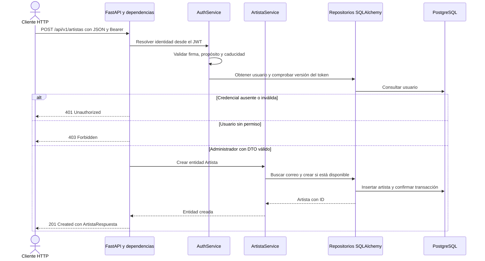
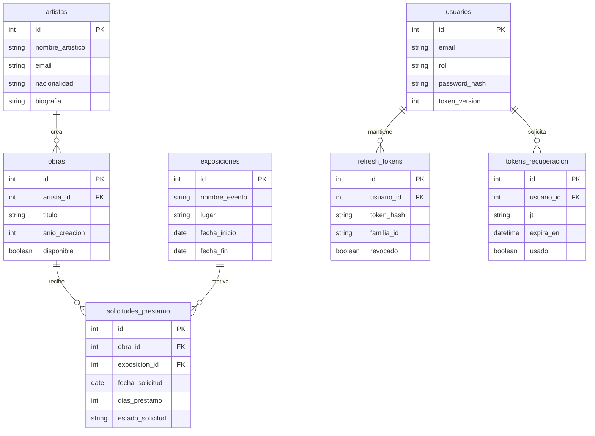

# Arquitectura y modelo de datos

## Alta de un artista

La ausencia de Bearer se detecta en las dependencias antes de consultar al usuario. Para un token válido, el backend consulta la identidad persistida antes de autorizar la operación.

| Responsabilidad | Implementación |
| --- | --- |
| Recibir el JSON, validar campos y formar la respuesta | [Router de artistas](../app/presentation/routers/artistas.py) y [DTO](../app/presentation/schemas/artista_schema.py) |
| Extraer la credencial y exigir rol de administrador | [Dependencias HTTP](../app/presentation/dependencies.py) |
| Validar identidad, estado de cuenta y versión de sesión | [Servicio de autenticación](../app/application/services/auth_service.py) y [validación criptográfica](../app/infrastructure/security/jwt_manager.py) |
| Representar el artista y comprobar duplicados | [Entidad de dominio](../app/domain/artista.py) y [servicio](../app/application/services/artista_service.py) |
| Convertir entre entidad y registro, escribir y leer el ID | [Mapper](../app/infrastructure/mappers/artista_mapper.py) y [repositorio SQLAlchemy](../app/infrastructure/repositories/artista_repository.py) |
| Convertir errores de aplicación en respuestas HTTP | [Manejadores de errores](../app/presentation/error_handlers.py) |

## Entidades y relaciones

El diagrama muestra las siete tablas de negocio y seguridad y sus relaciones por clave foránea. Cada tabla tiene una clave primaria `id`. En una relación uno a muchos, el lado derecho puede tener cero o más filas.

Los atributos mostrados permiten seguir los flujos de creación, préstamo y seguridad. Los tipos y restricciones completos están en los [modelos ORM](../app/infrastructure/models/) y en las [migraciones Alembic](../migrations/versions/).
